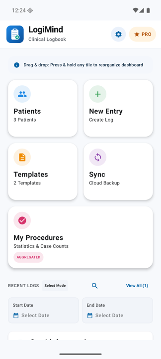
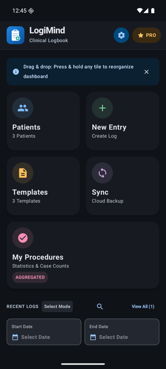
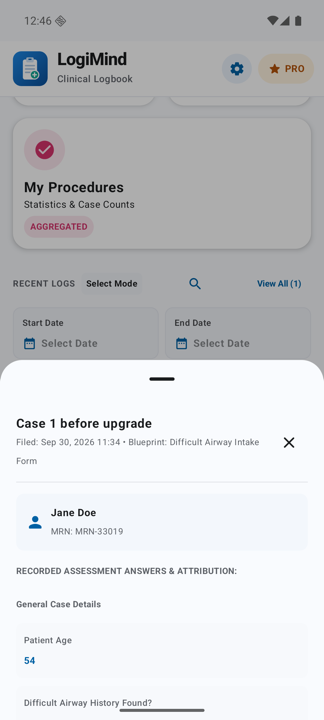
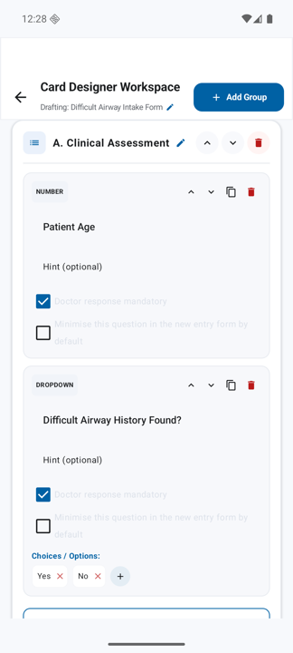
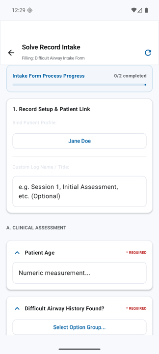
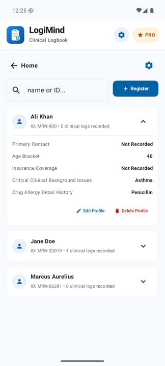

<div align="center">


# LogiMind

**Clinical logbook and form builder for Android**

Design your own clinical forms, log cases against patients, track the procedures you perform, and export clean reports. Everything stays on your phone.


</div>

---

## Screenshots

| Home | Dark mode | Case log |
| :---: | :---: | :---: |
|  |  |  |

| Form designer | Filling a form | Patients |
| :---: | :---: | :---: |
|  |  |  |

## What it does

**Build your own forms**
- Templates made of sections and questions: text, notes, numbers, dates, dropdowns, radio buttons, checkboxes and checkbox groups
- Show or hide a question based on another answer
- Mark checkboxes as procedures and ask "Did I perform this?"
- Hints, required questions, advanced choices, drag to reorder, duplicate, pin and archive templates

**Log cases**
- Link each entry to a patient profile (MRN, age, allergies and your own intake questions)
- Supervisor / witness and "verified" on each procedure
- Drafts are kept if the app closes before you save; "Repeat as new entry" for similar cases
- Search by patient, MRN, template or any answer; filter by date

**Track your procedures**
- *My Procedures* dashboard with counts per procedure, filters and drill-down
- Procedure report PDF: totals per procedure and per month, performed vs assisted, case list

**Export and back up**
- PDF, CSV (one column per question) and ZIP exports
- Full JSON backup and safe restore that never deletes what is already on the phone
- Daily automatic backup inside the app and a reminder to export a copy

**AI summaries**
- Three purposes, chosen automatically from the selected logs: **Case summary**, **Patient timeline** and **Logbook** (procedures performed by me / assisted / role not recorded, with supervisors and totals)
- Works offline on the phone, or with Google Gemini using your own API key (Fast or Better model)
- De-identified: patient names, MRNs, phone numbers and entry titles are never sent; patients become "Patient 1" and the real name is shown only on your phone. Free-text answers are sent as written
- Strict rules: only recorded data, "Not recorded" instead of guesses, roles kept exactly; every summary is marked as an AI draft to check
- "What will be sent?" preview, copy and share

**Privacy and comfort**
- Works fully offline; no account needed
- Optional app lock with the phone's PIN or fingerprint
- API key stored encrypted with the Android Keystore
- Light, dark or follow-the-phone theme
- Large, rounded icons and touch targets; readable at large system text sizes

## Upgrading from version 1.0

Version 1.1 keeps the database exactly as it was (Room schema version 3), so installing it **over** the old app keeps every template, patient and log entry. On first start it also saves a full safety backup inside the app.

Android only allows an in-place update when the new build is signed with the **same key** as the installed one. If your copy was installed from Google AI Studio and you now build elsewhere, export a backup from the old app first (or copy the data with `adb`), then install and restore. See [AI_BUILDER_GUIDE.md](AI_BUILDER_GUIDE.md), section 1.4.

## Build and run

Requirements: Android Studio (recent), Android SDK 36, JDK 17 or newer.

```bash
git clone https://github.com/Gitiverse/Logapp_android.git
cd Logapp_android
./gradlew :app:assembleDebug      # APK in app/build/outputs/apk/debug/
./gradlew :app:installDebug       # install on a connected device or emulator
```

Or open the folder in Android Studio and press **Run**.

- **Signing:** debug builds use `debug.keystore` in the project root when present (as in AI Studio), otherwise your local Android Studio debug key. Release builds read `KEYSTORE_PATH`, `STORE_PASSWORD` and `KEY_PASSWORD` from the environment. Never commit keystores.
- **Gemini (optional):** paste your key in the app under *Settings → Gemini API Key*.

## Tests

```bash
./gradlew :app:testDebugUnitTest
```

The unit tests (Robolectric) cover the things that protect users' data:

- the database schema has not changed (`SchemaFreezeTest`)
- editing sections, templates and entries never deletes their children
- old (v1) and new (v2) backups restore without losing anything
- undo after delete, patient edits, CSV layout
- show/hide rules, procedure answers and date filters
- AI summaries: nothing identifying is sent, roles are never swapped, every procedure is listed, hidden questions stay out

## Project structure

```
app/src/main/java/com/example/
├── MainActivity.kt              screen switching, theme, app lock
├── data/
│   ├── local/                   Room database and DAO (schema frozen at v3)
│   ├── model/                   entities, show/hide rules, procedure answers
│   ├── repository/              data access + transactions
│   └── service/                 exports & backup, AI summaries, secret storage
└── ui/
    ├── screens/                 Home, Form, Template designer
    ├── theme/                   colours, light/dark themes
    └── viewmodel/               app logic
app/schemas/                     exported Room schema (do not change)
docs/                            logo and screenshots
```

## For contributors

Read **[AI_BUILDER_GUIDE.md](AI_BUILDER_GUIDE.md)** before changing anything. It lists the rules that keep existing users' data safe (frozen database, app ID, signing key and settings keys), the full code audit, what has been fixed, and what is still open.

## Roadmap

- Release signing and code shrinking (R8)
- Larger touch targets and translations
- Optional cloud sync between devices
- More AI engines

---

<sub>LogiMind is a logbook and documentation tool. It does not give medical advice; AI summaries must be checked by a clinician.</sub>
